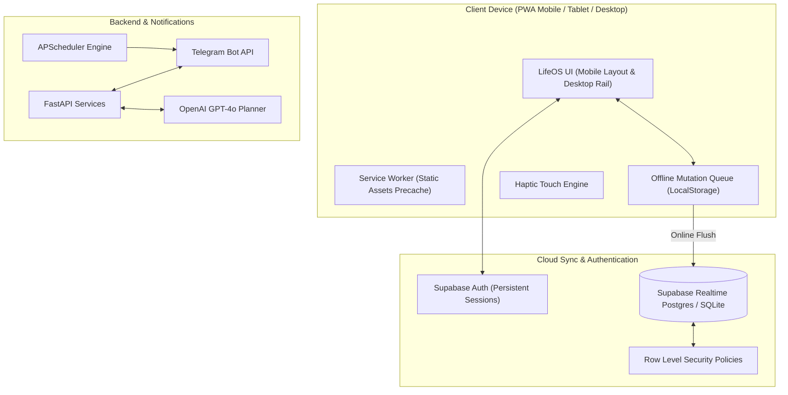

# LifeOS Daily Planner (Mobile-First PWA)

A personal productivity Progressive Web App combining **React + Tailwind CSS**, **Supabase Cloud Sync**, **Python FastAPI**, **SQLite**, **Telegram Bot API**, **OpenAI API**, and **APScheduler**.

---

## 📱 Mobile-First PWA Capabilities

- **App-Like Full-Screen Experience:** Runs as a standalone app on iOS, Android, and desktop without browser address bars.
- **Home Screen Installation:**
  - **Android & Chrome:** 1-tap "Install App" prompt.
  - **iOS Safari:** Interactive "Add to Home Screen" instructions.
- **Offline-First Resilience:**
  - Tasks, schedule slots, and habits are stored locally.
  - Offline mutations are enqueued in `localStorage`.
  - When network connectivity returns, mutations auto-flush to Supabase.
  - **Zero user data in service worker cache** (only UI shell & static assets precached).
- **Push & Telegram Notifications:**
  - Web Push notifications for scheduled tasks on supported devices.
  - Telegram Bot alerts (`/today`, `/add`, `/done`, `/habits`) as an always-reliable mobile alternative.
- **Cross-Device Authentication & Sync:**
  - Supabase Auth (persistent session across restarts).
  - Row Level Security (RLS) guaranteeing data privacy.

---

## 🏛️ Architecture & Data Flow



---

## 📁 Project Structure

```
d:/TASK MANAGER/
├── backend/                       # Python FastAPI Backend
│   ├── app/
│   │   ├── api/                   # REST API routes (tasks, habits, schedule, telegram, ai)
│   │   ├── core/                  # Configuration & SQLite setup
│   │   ├── models/                # SQLAlchemy database models
│   │   ├── schemas/               # Pydantic schemas
│   │   ├── services/              # Telegram bot, OpenAI & APScheduler
│   │   └── main.py                # FastAPI entry point
│   ├── .env.example
│   └── requirements.txt
│
├── frontend/                      # React PWA Dashboard
│   ├── public/                    # App icons (192x192, 512x512, apple-touch-icon, maskable)
│   ├── src/
│   │   ├── components/
│   │   │   ├── auth/              # AuthModal (Sign In, Sign Up, Profile)
│   │   │   ├── dashboard/         # ProgressSummary, TodaySchedule, TaskList, HabitTracker, EditScheduleModal
│   │   │   ├── layout/            # Desktop Sidebar & Desktop Header
│   │   │   ├── mobile/            # MobileHeader & MobileBottomNav (FAB, touch targets)
│   │   │   └── pwa/               # InstallPwaModal & OfflineBanner
│   │   ├── context/               # AuthContext & TaskContext (offline-first sync)
│   │   ├── services/              # supabase.js, offlineQueue.js, notifications.js
│   │   ├── App.jsx                # Responsive dual-layout controller
│   │   ├── index.css              # Safe-area insets & mobile touch optimizations
│   │   └── main.jsx
│   ├── index.html                 # PWA meta tags & apple-mobile-web-app configuration
│   ├── vite.config.js             # vite-plugin-pwa Workbox precaching configuration
│   ├── tailwind.config.js
│   └── .env.example
│
├── supabase_schema.sql            # Complete Supabase SQL migration & RLS policies
├── start_frontend.bat             # 1-click frontend dev runner
├── .gitignore
└── README.md
```

---

## ⚡ Quick Start

### 1. Launch Frontend PWA
```bash
cd frontend
npm.cmd run dev
```
Or double-click `start_frontend.bat`.

### 2. Connect Supabase (Optional for Cloud Sync)
1. Create a project at [supabase.com](https://supabase.com).
2. Run the SQL script from [supabase_schema.sql](file:///d:/TASK%20MANAGER/supabase_schema.sql) in the Supabase SQL Editor.
3. In `frontend/.env`, set:
   ```env
   VITE_SUPABASE_URL=https://your-project.supabase.co
   VITE_SUPABASE_ANON_KEY=your-anon-key
   ```
*(If no keys are provided, LifeOS automatically operates in Local Demo / Offline Mode).*
